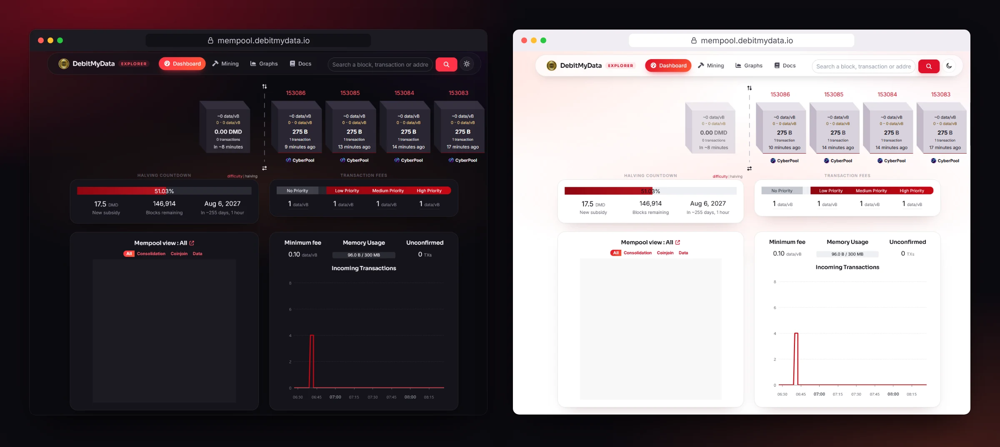

# DebitMyData Explorer

The block explorer of the DebitMyData (DMD) chain, live at
[mempool.debitmydata.io](https://mempool.debitmydata.io): every block, transaction and address,
the transactions waiting to be mined, fees, mining pools and the network's figures, as they
happen.

It is built on [mempool](https://github.com/mempool/mempool) (release v3.3.2), the open-source
explorer behind mempool.space, adapted to DebitMyData. This branch, `debitmydata`, holds the
DebitMyData explorer; `master` follows the mempool project.

## What it shows

- **The chain live**: new blocks and the next blocks forming from the waiting transactions, with
  their fees, sizes and timing.
- **Every block, transaction and address**, with a search box that knows DebitMyData's addresses
  (`D…` and `dm1…`).
- **Fees**: what to pay for a transaction to be mined soon, in `data/vB`.
- **Mining**: the pools and their share of the blocks, with their logos, from
  [DebitMyData's public pool list](https://github.com/DebitMyData-PoW/mining-pools); the
  hashrate and the difficulty.
- **The rich list**: the top holders, from 10 to 500, with the owners' names for known exchanges and
  pools, and the circulating supply.
- **An open API**, documented on the site (Docs → API).

## What differs from mempool

- **The network**: DebitMyData's addresses, its node (RPC port 18557), its 150-second blocks and
  its difficulty, which adjusts at every block (LWMA).
- **Units**: DMD and `data`, its smallest unit; fee rates in `data/vB`.
- **The rich list**: a page, the API endpoints `/api/v1/richlist`, `/api/v1/richlist/summary` and
  `/api/v1/circulating-supply`, and an indexer service (`richlist/`) that keeps every address's
  balance.
- **Exchanges**: known exchange addresses, from
  [DebitMyData-PoW/exchanges](https://github.com/DebitMyData-PoW/exchanges) (`/api/v1/exchanges`).
- **Mining pools**: DebitMyData's pool list and logos instead of Bitcoin's.
- **Prices**: DebitMyData's price feed, kept with 8 decimals.
- **The look**: DebitMyData's light and dark themes, its logo, top bar and footer, in the Aurora
  design of the other DebitMyData sites.

## Installation

To run the explorer on a server of your own, see **[INSTALL.md](INSTALL.md)**. The mempool
project's own documentation is in [backend/](backend/README.md), [frontend/](frontend/README.md)
and [docker/](docker/README.md).

## License

GNU Affero General Public License v3, as mempool ([LICENSE](LICENSE)). The mempool name and logos
are trademarks of Mempool Space K.K.; this explorer uses DebitMyData's own name and logos.
